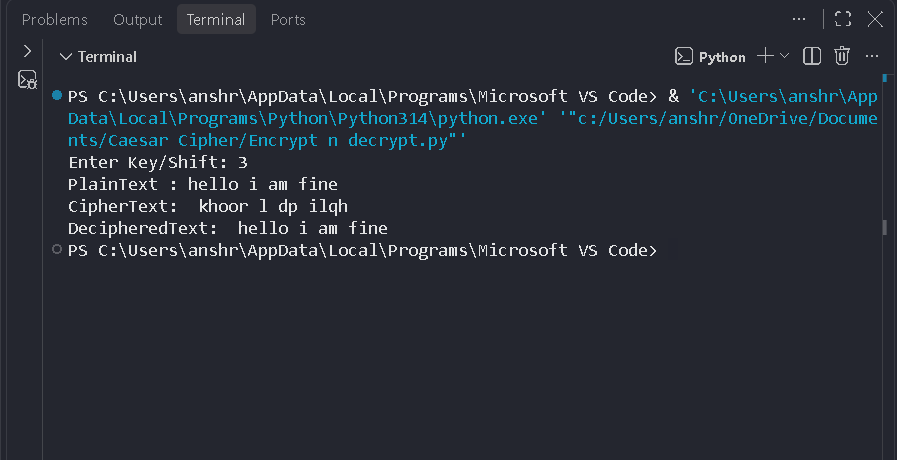

# Caesar Cipher: Encryption and Decryption

Project 2, DecodeLabs Cyber Security Internship | Built by Anshra | Python 3

A small Python program that encrypts text with a Caesar cipher and then decrypts it back, so you can see both results side by side. I built it as Project 2 of the cybersecurity internship at DecodeLabs.

## What it does

You enter a key (the shift) and some text. The program moves every letter forward by the key, wrapping back to `a` after `z`, and prints the encrypted text. It then decrypts that text with the same key and prints it again, which shows the original message comes back.

Spaces, numbers and punctuation are left exactly as they are. Only the letters a to z are shifted.

## How to run it

1. Install Python 3.
2. Open a terminal in the project folder.
3. Run `python "Encrypt n decrypt.py"` (the quotes are needed because the file name has spaces).
4. Type the key first, as a whole number like `3`, then type the text.

Keys bigger than 26 still work, because the alphabet wraps around. A key of 30 gives the same result as a key of 4.

## How it works

The program turns each letter into a number, shifts it, and turns it back:

- `ord()` changes a letter into its number, and `chr()` changes a number back into a letter.
- Encryption uses `(x + key) % 26` and decryption uses `(x - key) % 26`, where `x` is the letter's position from 0 to 25.
- The `% 26` is what makes the alphabet wrap around. For example, with key 3, `y` is position 24. Adding 3 gives 27, and `27 % 26` is 1, which is `b`.
- Anything that is not a letter from a to z is added to the result without changing it.

The same key locks and unlocks the message, so this is a symmetric cipher.

## Example run

```text
Enter Key/Shift: 3
PlainText : hello i am fine
CipherText:  khoor l dp ilqh
DecipheredText:  hello i am fine
```



*Figure 1: The program encrypting and decrypting with key 3.*

## Test results

I tried these inputs, and each one decrypts back to the original text:

| Text | Key | Encrypted text | What it shows |
| --- | --- | --- | --- |
| `hello i am fine` | 3 | `khoor l dp ilqh` | Spaces are kept |
| `how are you` | 7 | `ovd hyl fvb` | A bigger shift |
| `hello` | 2 | `jgnnq` | A basic case |
| `xyz` | 3 | `abc` | Letters wrap around after `z` |
| `hi, there! 123` | 5 | `mn, ymjwj! 123` | Punctuation and numbers stay the same |
| `Hello World` | 3 | `khoor zruog` | Capital letters become lowercase |

## How the code is organised

- `Ceaser_encrypt(text, s)` goes through the text one character at a time and shifts each letter forward by the key `s`.
- `Ceaser_decrypt(text, s)` does the same but shifts backwards, which undoes the encryption.
- The bottom of the file asks for the key and the text, then prints the encrypted and decrypted results.

## What I learned

- How `ord()` and `chr()` let me do maths on letters by turning them into numbers and back.
- How the modulo operator `%` makes the alphabet wrap around, so `z` followed by a shift of 1 goes back to `a`.
- That decryption is the same shift in the other direction, using the same key.
- That I need to leave non-letters alone, or spaces and punctuation turn into the wrong characters.

## Limitations and what I would do next

- **Capital letters become lowercase.** The text is lowercased before it is encrypted, so the original capitals cannot be restored.
- **A key that is not a whole number crashes the program.** If I type text at the key prompt, it stops with a `ValueError`. Next time I would ask again until the key is a number.
- **Only a to z are shifted.** Accented letters and other symbols pass through unchanged.
- **There is no separate decrypt mode.** The program decrypts the text it just encrypted, so it cannot decrypt a message that someone else sent.
- **The cipher is not secure.** There are only 25 useful shifts, so it can be broken by trying them all, and the letter patterns stay the same. It is for learning the idea of encryption, not for protecting real data.

## Tools used

Python, VS Code and Git. I followed a YouTube tutorial for the Caesar cipher logic and then adapted it so that spaces and punctuation are kept.