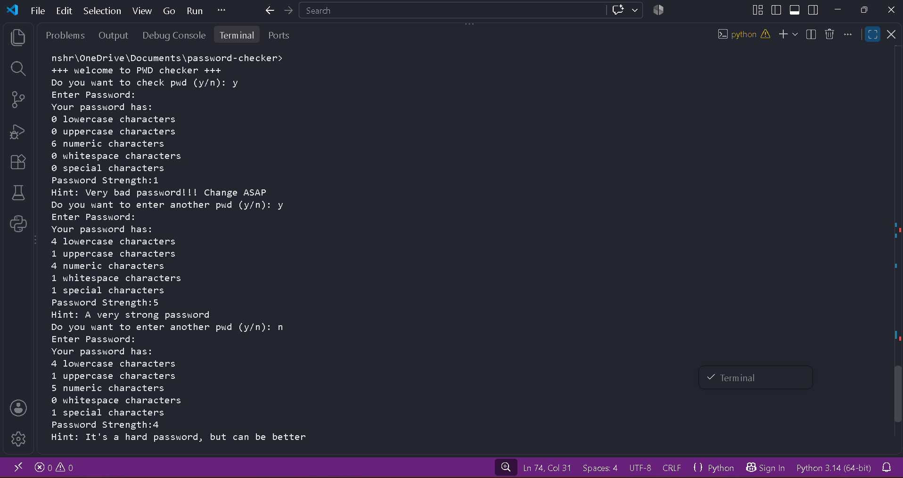

# Password Strength Checker

Project 1, DecodeLabs Cyber Security Internship | Built by Anshra | Python 3

A small command-line program that looks at a password, tells you what it's made of, and gives it a strength score out of 5 with a short hint. I built it as Project 1 of the cybersecurity internship at DecodeLabs.

## What it does

The program asks for a password and counts how many lowercase letters, uppercase letters, numbers, spaces and special characters it has. Each kind that shows up earns one point, and the total becomes the strength score. It then prints the counts, the score and a hint about whether the password needs changing.

The password is hidden while you type, so it works like a real login form and nobody looking over your shoulder can read it. When it finishes, it asks if you want to check another one. Typing `n` ends the program.

## How to run it

1. Install Python 3 (it uses f-strings, so 3.6 or newer).
2. Open a terminal in the project folder.
3. Run `python my_checker.py`.
4. Answer `y` at the first question, then type a password and press Enter. Nothing shows on screen while you type.
5. Answer `y` to check another password, or `n` to quit. Any other answer makes it ask again.

## How the score works

Each of these earns one point, no matter how many times it appears:

| Character type | Points |
|, |, |
| Lowercase letter | 1 |
| Uppercase letter | 1 |
| Number | 1 |
| Space | 1 |
| Special character (anything else, like `!` or `&`) | 1 |

The score is the total, so it goes from 0 to 5. The hint depends on the score:

| Score | Hint |
|, |, |
| 1 | Very bad password!!! Change ASAP |
| 2 | Not a good password!!! Change ASAP |
| 3 | It's a weak password, consider changing |
| 4 | It's a hard password, but can be better |
| 5 | A very strong password |

## Example run

The password you type is hidden, so it doesn't appear in the real terminal either. Here's what I get for `qwerty` and `Blue7Horse21&Tree21!`:

```text
+++ welcome to PWD checker +++
Do you want to check pwd (y/n): y
Enter Password:
Your password has:
6 lowercase characters
0 uppercase characters
0 numeric characters
0 whitespace characters
0 special characters
Password Strength:1
Hint: Very bad password!!! Change ASAP
Do you want to enter another pwd (y/n): y
Enter Password:
Your password has:
10 lowercase characters
3 uppercase characters
5 numeric characters
0 whitespace characters
2 special characters
Password Strength:4
Hint: It's a hard password, but can be better
Do you want to enter another pwd (y/n): n
```



*Figure 1: The checker running in VS Code.*

## Test results

I tried these passwords to see how the scoring behaves:

| Password | Score | What it shows |
|, |, |, |
| `123456` | 1 | Only numbers, so only one point |
| `qwerty` | 1 | Only lowercase letters, so only one point |
| `Blue7Horse21` | 3 | Lowercase, uppercase and numbers |
| `Blue7Horse21&Tree21!` | 4 | Adds special characters, but no space |
| `Blue7 Horse21&Tree!` | 5 | Adds a space, so all five types are present |

## How the code is organised

- `check_pwd()` asks for the password with `getpass`, goes through it one character at a time, and sorts each character into a group using the `string` module. Then it adds up the points and prints the results.
- `ask_pwd()` asks the yes or no question and keeps asking until the answer is `y` or `n`. It takes a flag so the wording changes between the first question and the "another password" question.
- The bottom of the file prints the welcome message and runs the program in a loop until the answer is `n`.

## What I learned

- How to read a password one character at a time and sort each character into a group using `string.ascii_lowercase`, `string.ascii_uppercase` and `string.digits`.
- How `getpass` hides what you type, which is what a real login form does.
- That splitting the work into two small functions, one for checking and one for asking questions, makes the program easier to read.

## Limitations and what I would do next

- **Length isn't checked.** A short password like `aA1!` scores 4 out of 5.
- **A space is needed for a perfect score.** A long password with letters, numbers and symbols but no space tops out at 4. `Blue7Horse21&Tree21!` is a good example.
- **Common passwords aren't checked.** A password like `Password123!` scores 4 out of 5.
- **An empty password scores 0**, and the hint comes out blank.

## Tools used

Python, VS Code and Git. I wrote the code myself.